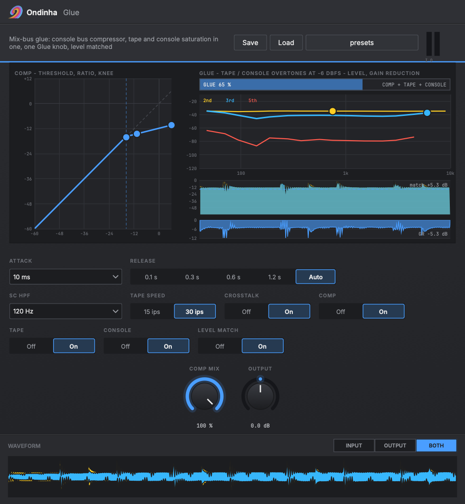

# Ondinha Glue

**Mix-bus glue in one plug-in: a console bus compressor, tape and console saturation, one Glue knob, level matched. Alias-free, transparent at zero.**

A VST3 and Audio Unit plug-in from [Ondinha](https://github.com/ondinha), a DAW 2.0: native AI tools combined with traditional sound engineering tools.



A digital mix often sounds like tracks played next to each other rather than together. On an analog desk, three things glue them: the bus compressor moves the parts as one, the tape rounds the peaks and the loud highs, and the console's amps and transformers add density and weight. Glue does all three in one window.

- **Comp:** a console bus compressor (feed-forward VCA, stepped ratio, attack and release, an auto release, side-chain high-pass, parallel mix).
- **Tape:** pre-emphasis, a soft curve and de-emphasis, so loud highs saturate first and quiet ones pass. Then the head bump of 15 or 30 ips tape.
- **Console:** the amp (2nd harmonic first), then the output transformer, which saturates the lows on their own curve for weight. Left and right differ slightly, like real hardware, with optional crosstalk.

**Glue** sets how much of all three you hear: it blends the tape and console colour in and drives the compressor. Each stage keeps its own settings and can be switched off. **Level match** keeps the output as loud as the input, so you judge the glue, not the volume. With Glue at zero, the output is the input, bit for bit.

## What it's good for

- **Mix bus:** Glue around 40 to 60 % with level match on. The mix gets denser and moves as one, without getting louder or duller.
- **Rock and metal buses:** guitars, bass and drums that sit side by side get pulled together. The side-chain high-pass keeps the kick from pumping the mix.
- **Drum bus:** a faster comp, parallel mix and 15 ips tape: punchier hits with a rounder top.
- **Masters:** tape or console alone with the comp off: a little colour and peak rounding before the limiter.

## The window

- **Comp:** the transfer curve at the threshold Glue gives it now. Drag threshold, ratio and knee on it; the live level rides on the curve.
- **Glue:** the 2nd, 3rd and 5th overtones tape and console add, across frequency, at the music's peak level now. They're measured by running the plug-in's own processing on test tones whenever a setting changes. Drag **TAPE** and **CONSOLE** up or down for drive, and the **GLUE** bar left or right.
- **History:** input and output level, the gain reduction, and the level match's gain.
- **Waveform:** the input and output over the last seconds.

A handle shows its value while you drag. Double-click resets, alt gives fine control, and every drag is one undo step and one automation gesture in your DAW.

## Controls

| Control | Range | What it does |
|---|---|---|
| Glue | 0 to 100 % | How much tape and console colour you hear, and how hard the compressor works |
| Threshold | -40 to 0 dB | Where the compressor starts (Glue lowers it by up to 12 dB onto this value) |
| Ratio | 1.5, 2, 4, 10 : 1 | Compression ratio |
| Attack | 0.1 to 30 ms | How fast the compressor reacts |
| Release | 0.1 to 1.2 s, Auto | How fast it lets go (Auto: fast after short peaks, slow under sustained compression) |
| SC HPF | Off to 200 Hz | Keeps the lows out of the detector |
| Knee | 0 to 12 dB | How soft the knee is |
| Comp mix | 0 to 100 % | Parallel compression |
| Tape drive | 0 to 100 % | How hard the tape is hit |
| Tape speed | 15 / 30 ips | Where the head bump sits |
| Console drive | 0 to 100 % | How hard the console's amp and transformer are driven |
| Crosstalk | Off / On | A little of the other side (-40 dB, high-passed) |
| Comp / Tape / Console | Off / On | Each stage on its own |
| Level match | Off / On | The output follows the input's loudness (K-weighted, about 3 s) |
| Output | +-12 dB | Output level |

## Presets

Built in as host programs (your DAW's preset menu). Inside Ondinha you can also save your own.

- Gentle mix glue
- Rock bus
- Drum bus
- Master tape
- Console only

## Download and install

**[Download the latest release](https://github.com/ondinha/ondinha-glue/releases/latest)** (macOS, Windows, Linux) or get it from the [product page](https://ondinha.app/plugins/glue).

**macOS:** copy `Ondinha Glue.vst3` to `~/Library/Audio/Plug-Ins/VST3` and `Ondinha Glue.component` to `~/Library/Audio/Plug-Ins/Components`. The plug-ins aren't notarized yet, so clear the download flag once:

```sh
xattr -dr com.apple.quarantine ~/Library/Audio/Plug-Ins/VST3/"Ondinha Glue.vst3" ~/Library/Audio/Plug-Ins/Components/"Ondinha Glue.component"
```

Then rescan plug-ins in your DAW.

**Windows:** copy the `Ondinha Glue.vst3` folder to `C:\Program Files\Common Files\VST3`, then rescan.

**Linux:** copy the `Ondinha Glue.vst3` folder to `~/.vst3`, then rescan.

| Format | Platform |
|---|---|
| VST3 | macOS (Apple Silicon + Intel), Windows 10+ (64-bit), Linux (x64) |
| Audio Unit (AU) | macOS |

Works in any VST3 or AU host: Ableton Live, Logic Pro, Reaper, Bitwig Studio, Cubase, Studio One, FL Studio and others.

## How it works

**Comp** is a feed-forward VCA with stereo-linked peak detection and a soft knee, computed in dB in double precision. Its envelope is a smooth decoupled detector (release, then attack; Giannoulis, Massberg, Reiss 2012), so the gain never steps. The auto release runs a fast and a slow stage; the slow one only charges under sustained compression.

**Tape** and the console's **amp** run 4x oversampled through linear-phase half-band FIRs, stricter than JUCE's maximum quality: -120 dB going back down to the base rate and -100 dB going up (an image left in the input would mix with the overtones back into the band). Measured: a hot 9 kHz tone's 3rd overtone folds back at -125 dB with both drives at 80 %.

Tape is a high-shelf pre-emphasis, a tanh curve with a slight bias (mostly 3rd harmonic, a little 2nd) and the exactly inverse de-emphasis, so loud highs saturate first. The head bump (+1.5 dB at 55 Hz for 15 ips, +1 dB at 100 Hz for 30 ips, with a smaller dip above) and the console's output transformer (the lows under about 120 Hz through their own soft curve) run at the base rate. Their overtones stay far under Nyquist.

Every stage adds only what its curve changes (x + amount x (curve(x) - x)), with that difference DC-blocked. A small drive leaves the sound untouched, and blending wet and dry never phases.

**Level match** compares the K-weighted (ITU-R BS.1770) power of the input and the result over about 3 seconds and applies the difference (+-12 dB, held in silence).

Latency is 81 samples at 48 kHz (about 1.7 ms), reported to the host. CPU is about 2 % of one core at 48 kHz.

## More Ondinha plug-ins

- [Ondinha Thicken](https://github.com/ondinha/ondinha-thicken): Makes thin, holey sounds full: lifts the dips in the tone, adds alias-free overtones where an EQ has nothing to boost, a second player.
- [Ondinha Split EQ](https://github.com/ondinha/ondinha-split-eq): Transient / tonal split EQ: separate gain for the attack and the sustain in every band.
- [Ondinha Bus Comp](https://github.com/ondinha/ondinha-bus-comp): Console-style glue compressor for the mix bus and groups (Glue's compressor on its own).
- [Ondinha Limiter](https://github.com/ondinha/ondinha-limiter): True-peak brickwall limiter for mastering, with an optional oversampled clipper.

## Feedback

Found a bug or a host where it misbehaves? [Open an issue](../../issues) with your DAW, its version and your OS.
